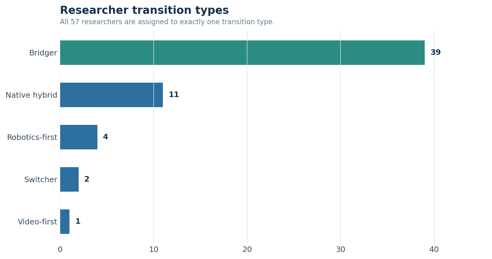
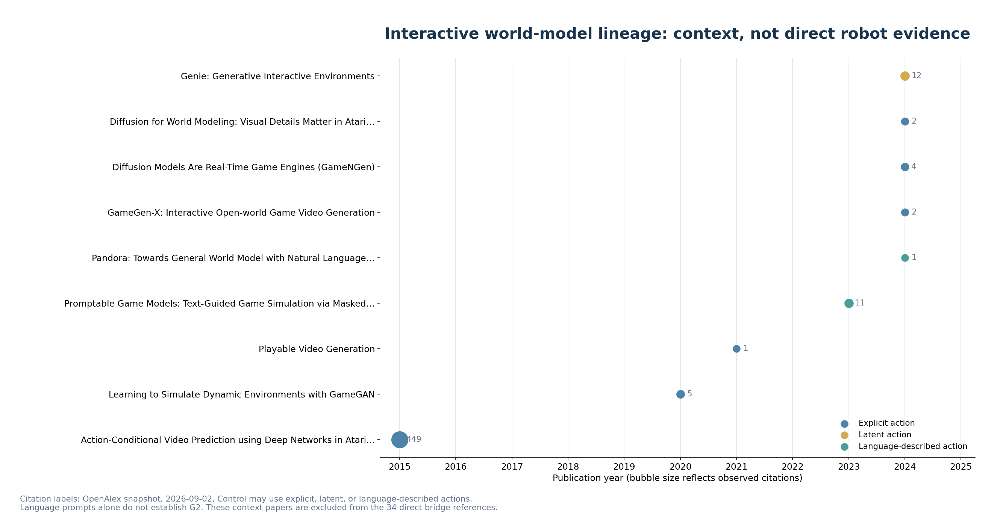
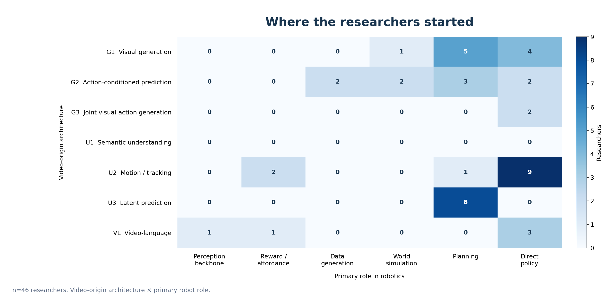
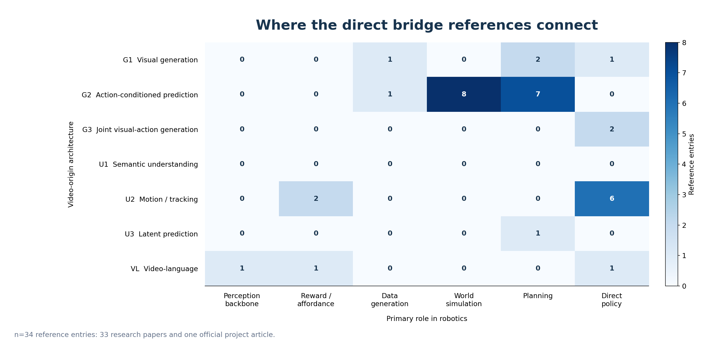
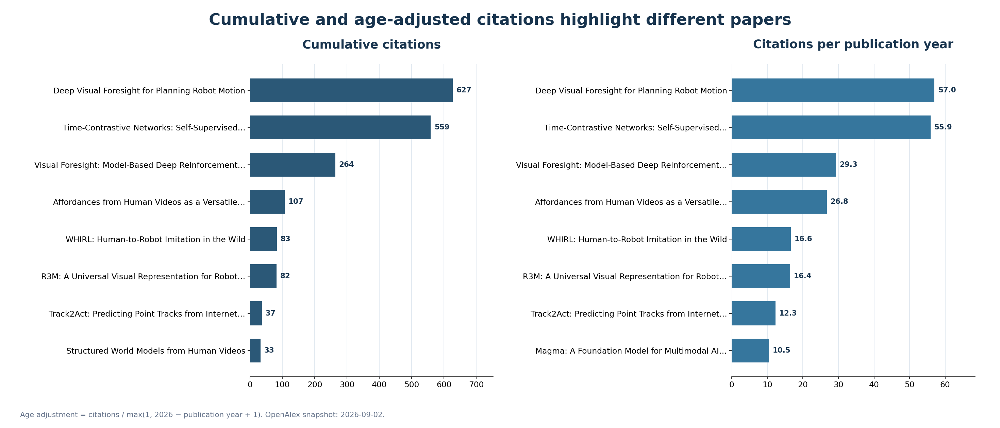

# From Video Models to Robotics

[한국어](https://2seungeun.github.io/2seungeun/notes/01-video-to-robotics-transition/) | **English**

By <a class="article-author" href="https://www.linkedin.com/in/lee-seungeun" target="_blank" rel="author me noopener">Seungeun Lee</a> — <time datetime="2026-09-01">September 1, 2026</time> · Updated <time datetime="2026-11-03">November 3, 2026</time>

This note began with the impression that many people who worked on video were moving into robotics. Current affiliations alone did not tell that story very well. I needed to look at the video problems each researcher had worked on and where that experience later appeared in robotics.

The original analysis covers 46 researchers and 74 reference entries. The catalogue contains 73 research papers and one official 1X project article (P032). These are not one-to-one lists: a paper can have several relevant authors, and a researcher can appear on several papers. I selected one representative video paper and one representative robotics paper only when making researcher-level comparisons.

The reference entries are grouped by how they are used in the analysis.

| Reference group | Entries | Meaning | Spreadsheet label |
|---|---:|---|---|
| Direct bridge references | 34 | The paper or official project article shows a video representation, prediction, or generation mechanism being used for a robotics problem | Yes |
| Context and lineage papers | 22 | No direct robotics transfer is demonstrated, but the paper is needed to trace or compare the technical lineage | Adjacent |
| One-side reference papers | 18 | A representative video-side or robotics-side paper used to establish a researcher's starting point or destination | No |

## November 3, 2026 update: what happens after the bridge

Recent work makes the bridge from video prediction to robot action more concrete, while asking **which future information to predict and how to feed it back into learning**. The 10 selected additions below contain nine papers and one official announcement, including May–July backfills and September–November releases or revisions. This is a selective evidence update, not an exhaustive survey or a new researcher ranking.

| Reference · checked version | Mechanism / use | Evidence boundary |
|---|---|---|
| [Turning Video Models into Generalist Robot Policies (VERA)](https://arxiv.org/abs/2605.27817) · v1 · 2026-05-27 | G1 → Planning + video-to-action | Real-robot evidence; an action-free video planner is paired with an embodiment-specific inverse dynamics model. This is a backfill, not a new November paper. |
| [Cosmos 3: Omnimodal World Models for Physical AI](https://arxiv.org/abs/2606.02800) · v4 · 2026-06-23 | G2/G3 (task-dependent) → World simulation / policy backbone | Technical report for a multimodal world-model family. Assign codes per runtime/task, rather than treating the whole family as a single G2 or G3 experiment. |
| [WorldScape Policy 2.0](https://arxiv.org/abs/2607.18840) · v3 · 2026-10-20 | G3 → Direct policy | Joint visual-action modeling with visual and event memory; simulation and real-platform experiments. July work with an October revision. |
| [Robot-Factored World Models via Robot Rendering (RoFacto)](https://arxiv.org/abs/2607.22535) · v2 · 2026-11-02 | G2 → World simulation / data generation | Robot controller, kinematics and URDF rendering provide action conditions; the model predicts scene responses. November camera-ready revision reports embodiment transfer. |
| [Modality-Autoregressive World-Action Models (ModAR)](https://arxiv.org/abs/2609.17524) · v2 · 2026-10-08 | U2/U3 + multimodal prediction → Direct policy | Predicts future tracks, features and depth before actions. Trained from scratch; real bimanual tests. A video-pretraining benefit must not be inferred from this result. |
| [RoboCoach: World Models as Active Coaches for Compositional Robot Skills](https://arxiv.org/abs/2609.39685) · v1 · 2026-09-30 | G2 → Evaluation → targeted supervision | Imagined subtask failures guide demonstration requests and expert updates; matched-budget comparisons and real-robot tests. Extends the original role taxonomy with an explicit coaching use. |
| [R²-WAM: Repair-and-Reject Post-Training for World Action Models](https://arxiv.org/abs/2610.04913) · v2 · 2026-10-07 | G2/G3 system → Policy refinement | Repairs action-video consistency before rejecting inferior action samples for post-training. Real-robot evidence. Distinct from N08 and N09 despite the shared R²-WAM name. |
| [What Visual Representations Do World Action Models Need?](https://arxiv.org/abs/2610.13024) · v1 · 2026-10-09 | G3 + visual representations → Direct policy | Controlled representation/integration comparisons for WAMs; channel-wise joint future-feature prediction is effective. Representation Recipe (R²-WAM), not repair-and-reject or replay. |
| [Data-Free Continual Learning for World Action Model with Rectified Generative Replay](https://arxiv.org/abs/2610.18038) · v2 · 2026-10-14 | G3 → Continual learning / generative replay | Generated observation-action rollouts rehearse past tasks; completion truncation and consistency filtering address replay failures. Real-robot tests; no old real training data is accessed. |
| [Genie 4: A new generation of world simulation](https://deepmind.google/blog/genie-4-a-new-generation-of-world-simulation/) · Official announcement · 2026-10-27 | G2 context (provisional) → Interactive simulation | Official preview includes Gemini-guided humanoid task simulation. This announcement alone does not demonstrate learned-policy transfer to physical hardware; retain as context, not a direct robot-transfer result. |

Three questions sharpen the original map. VERA and RoFacto specify the **action interface** between a video model and an embodiment. ModAR and the representation study examine **task-relevant future information** beyond pixel reconstruction. RoboCoach, repair-and-reject post-training, and rectified replay feed predictions into **data acquisition, policy improvement, and retention**. In addition to perception, simulation, planning and policy, the map should record how a model participates in a learning loop. This is an interpretation of the selected works, not a cross-paper performance comparison.

The 46-person / 74-reference counts and charts below describe the original sample. The ten additions are recorded separately in the workbook's `Update_2026_11_03` sheet and [machine-readable update](updates/2026-11-03.json). Together, the archive now holds 84 references, but the provisional new mechanism mappings are not merged into the original 34-reference direct-bridge matrix or researcher statistics. Citation counts and impact rankings remain the **September 2, 2026 snapshot**. New-paper citations were not collected and must not be interpreted as zero.

## The boundary was blurring more than people were switching fields

Each of the 46 researchers is assigned to exactly one of three transition types. Cases without a verified video starting point or an individual physical-robotics connection are excluded from this denominator.

| Type | Count | Meaning in this note |
|---|---:|---|
| Switcher | 1 | The primary topic or organization clearly moved from video toward robotics or world models |
| Bridger | 34 | Produced important work on both sides or directly connected the technologies |
| Native hybrid | 11 | Worked on video and robotics together from a relatively early stage |
| **Total** | **46** | Each researcher is counted once |

Only one person fit a narrow definition of switching fields. Far more common were the 34 `Bridgers` who continued to move between both areas or carried structures developed for video into robotics problems. The remaining 11 are `Native hybrids` who worked on both areas from the beginning.

This looks less like a mass migration of video researchers and more like two research areas becoming tightly entangled. My own interest also moved from video, through world models, toward robotics, which may be why I wanted to understand this flow more closely.

## Similar video models took on different roles in robotics

At first, I thought a split between video generation and video understanding would be enough. Once the papers were laid out together, however, the paths within those categories turned out to be different.

Video models that generate or predict future scenes tended to lead toward world simulation and planning. Models such as V-JEPA predict the future without reconstructing pixels, so I separated them from conventional video generation as `latent prediction`. Motion- and tracking-based understanding models (U2) most often led to direct robot policies, with smaller paths toward reward, affordance, and planning. Video-language (VL) denotes a video-and-language learning origin. In this sample it most often led to direct policy, as VLA systems do, while a smaller number of cases connected to perception or reward.

The vertical code axis answers one question only: **which video-side architecture the researcher or paper brings into robotics**. If a robot model emits actions, that information appears in the `Direct policy` column rather than creating another code. Track2Act is therefore U2 → Direct policy because it carries over point tracking, while GR-2 is G3 → Direct policy because it jointly generates visual states and actions.

### Video-origin architecture codes

| Code | Short meaning | Boundary | Common robotics role |
|---|---|---|---|
| G1 | Visual generation | Generates image or video pixels or tokens; robot action is not a central input | Synthetic data, visual subgoals, video plans |
| G2 | Action-conditioned future prediction | Predicts future visual states conditioned on explicit, latent, or language-described control actions; does not jointly emit actions | World simulation, planning |
| G3 | Joint visual-action generation | Future visual states and actions are emitted together | Direct policy |
| U1 | Semantic and action understanding | Represents events, actions, or scene meaning | Perception backbone |
| U2 | Motion and tracking understanding | Represents motion, point tracks, interactions, or affordance | Perception, reward, policy conditioning |
| U3 | Latent future prediction | Predicts future representations rather than reconstructing pixels | Latent planning |
| VL | Video-language | Aligns temporal video information with language or reasons over both | Reward, reasoning, policy conditioning |

Within the generative family, action position separates G1, G2, and G3. G1 generates video without action as a central condition. G2 takes action as a condition but predicts future video. G3 jointly generates visual states and actions. Final robot outputs are represented by robot roles rather than by another code system. There is no separate A origin code. VL denotes a video-and-language learning origin; accepting language in a robot policy is insufficient. A G2 language condition must specify state-changing control actions; a descriptive scene prompt alone does not qualify.

<strong>Game-oriented G2 boundary cases</strong> <em>(expand)</em>

<a href="https://arxiv.org/abs/2408.14837">GameNGen</a> and <a href="https://arxiv.org/abs/2402.15391">Genie</a> are G2 because they generate the next visual state from past frames and actions, or from latent actions learned from video. Neither paper demonstrates transfer to a robot or physical system. They remain useful context for the technical lineage but are excluded from the 34 direct bridge references. <strong>Being G2</strong> and <strong>showing a robotics transfer</strong> are separate judgments.

The figure below shows a broader interactive world-model lineage. <a href="https://arxiv.org/abs/2406.09455">Pandora</a> and <a href="https://arxiv.org/abs/2303.13472">Promptable Game Models</a> control state changes through language-described actions. Language conditioning alone does not establish a G2 or VL origin. Citation labels use the same September 2, 2026 OpenAlex snapshot as the spreadsheet.

## G1 researchers reached planning most often, while direct bridge references were dominated by G2

Both figures use the same architecture codes and the same robot roles. The first counts 46 researchers; the second counts the 34 direct bridge references. G3 had previously appeared as zero at researcher level. After rechecking Cosmos Policy's authors and architecture, Moo Jin Kim and Yihuai Gao are now correctly shown as G3 → Direct policy. GR-2 and Cosmos Policy are the two G3 papers in the reference-entry chart.

G1 → Planning contains five researchers: Yilun Du, Jiajun Wu, Karthik Dharmarajan, Ruohan Zhang, and Wenlong Huang. Sherry Yang is not an author of UniPi, so I removed her from that path and reassigned her to G2 → World simulation through UniSim, which she led.

At reference-entry level, G1 maps to one data-generation entry, two planning entries, and one direct-policy entry. G2 maps to one data-generation entry, eight world-simulation entries, and seven planning entries.

At researcher level, G1 maps to planning for five people, direct policy for four, and world simulation for one. G2 maps to planning for three, with two each in world simulation, direct policy, and data generation. G1 researchers reached planning most often, but the direct reference set contains far more G2 entries (16) than G1 entries (4). The clearest reference-entry path in this sample runs from **action-conditioned future prediction to world simulation and planning**.

Separating generation, understanding, and video-language—and then tracing their roles in robotics—changed my initial impression. The larger pattern seems to be less about people moving fields and more about **representations and predictive structures learned from video moving into robotic world models, planning, and policies**.

## Reference

The spreadsheet contains the 46-researcher table, the 74-entry reference catalogue, researcher and paper matrices built from one code system, transition counts, classification rules, and source links. For this re-audit, I matched representative-paper links against author lists again. Andrea Vedaldi, João Carreira, José Lezama, Lijun Yu, Tim Brooks, and Xun Huang were removed from the researcher sample because I could not verify an individual physical-robotics connection under the stated rule. The `Audit_Log` sheet records the detailed corrections.

- [Download the research data](video_to_robotics_architecture_pilot.xlsx)
- Citation snapshot: September 2, 2026

### I looked at both cumulative and age-adjusted citations

All citation counts use the [OpenAlex](https://openalex.org/) cited_by_count snapshot from September 2, 2026. Different scholarly search services merge paper versions differently, so these are source-specific values intended for comparison within one snapshot.

Cumulative citations favor older papers. I therefore added a simple age-adjusted view:

$$
\text{Citations per year}
= \frac{\text{Observed citations}}
{\max(1,\ 2026-\text{publication year}+1)}
$$

Under this convention, a 2025 paper is in its second publication year and a 2023 paper in its fourth. This is not a month-level citation velocity or a field-normalized metric; it is only a rough check on paper age.

The researcher score is calculated only when the representative video and robotics papers are **two distinct papers**:

$$
\text{Bridge Impact}
= \sqrt{(C_{video}+1)(C_{robotics}+1)} \times w_{evidence}
$$

Evidence_strength receives a weight of 1.0 for High and 0.8 for Medium. High means direct authorship on both sides or a verified official project role. Medium means one side relies on a team announcement, a recent project page, an indirect technical lineage, or authorship that could not be verified with enough confidence. The 0.8 weight is a conservative rule, not a statistically estimated coefficient.

When a single paper directly bridges video and robotics, it remains an important bridge case. The ranking, however, compares influence verified through two distinct papers, so single-paper cases are reported separately rather than scored. Samarth Sinha's connection is supported by his profile and the official World Model Lab announcement. P032 is an official project article rather than an authored research paper, so this case is reported separately from paper-based scoring. The 46 researchers divide as follows:

| Score-data status | Count | Ranking treatment |
|---|---:|---|
| Two distinct representative papers covered | 27 | Ranked only when Important_both=Yes; 23 people qualify |
| One bridge paper used on both sides | 18 | Excluded |
| Official project/role evidence | 1 | Excluded |
| Representative paper or citation input partially missing | 0 | Excluded |
| **Total** | **46** |  |

Under this rule, Chelsea Finn and Sergey Levine are tied for first, Deepak Pathak is third, Thomas Brox is fourth, and Xiaolong Wang is fifth. Agrim Gupta is tied for tenth.

### These numbers should not be read as a general ranking

Bridge Impact first selects people with important work visible on both the video and robotics sides, then scores that intersection. Researchers already known in both areas are likely to rank highly partly because of that sampling rule. The metric is not designed to discover new switchers independently or to measure overall career impact.

Selecting one or two representative papers also leaves out contributions, and citation counts cannot separate the roles of individual coauthors. Papers from 2025–2026 can change position quickly. Cumulative citations, the age-adjusted view, and the qualitative evidence should therefore be read together.

### Sample revision history

The September 5, 2026 re-audit reduced the researcher sample from 52 to 46 and retained all 66 existing reference entries while adding P067–P074, bringing the reference total to 74. Added entries and exclusion reasons are recorded in the [change log](https://2seungeun.github.io/2seungeun/notes/01-video-to-robotics-transition/revision-history.html). On September 30, 2026, representative-paper metadata, citation-source links, classification notes, and the lineage figure were corrected. The citation snapshot remains September 2, 2026.

© 2026 Seungeun Lee. All rights reserved.

