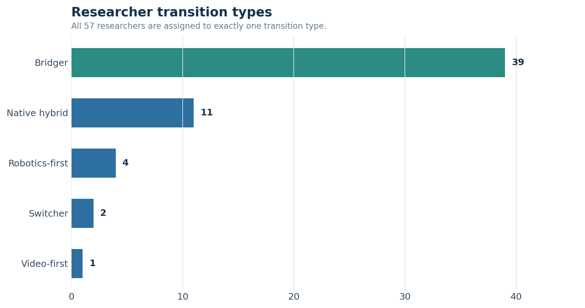
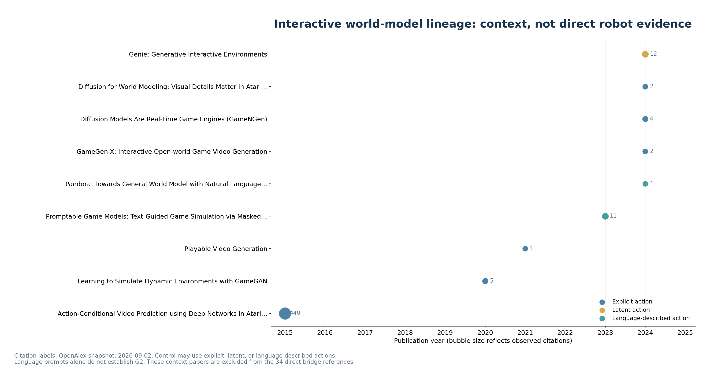
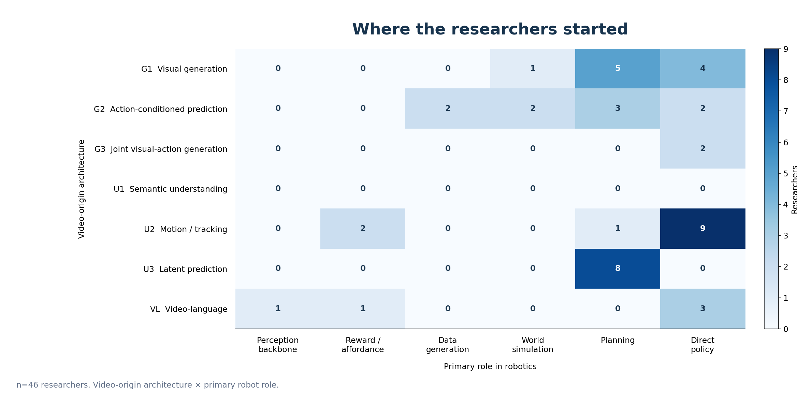
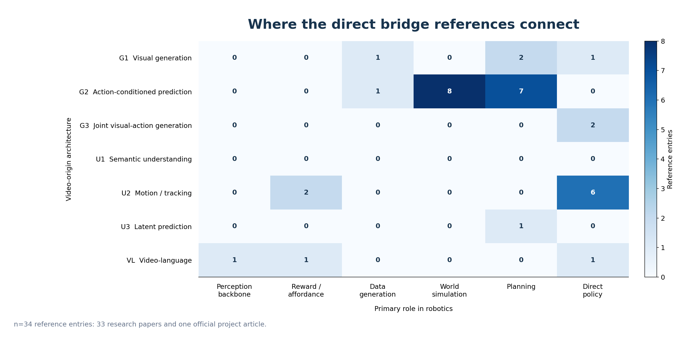
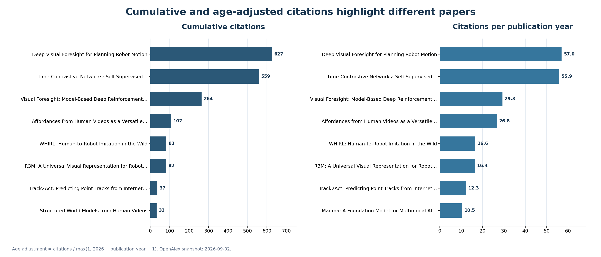

# 비디오 모델은 어떻게 로보틱스로 이어졌나

**한국어** | [English](https://2seungeun.github.io/2seungeun/notes/01-video-to-robotics-transition/english.html)

By <a class="article-author" href="https://www.linkedin.com/in/lee-seungeun" target="_blank" rel="author me noopener">이승은</a> — <time datetime="2026-09-01">2026년 9월 1일</time> · 수정 <time datetime="2026-11-03">2026년 11월 3일</time>

비디오를 하던 사람들이 로보틱스로 많이 넘어간 것 같다는 인상에서 시작했다. 그런데 사람의 현재 소속만 따라가서는 이 흐름이 잘 보이지 않았다. 원래 어떤 비디오 문제를 풀었는지, 그 경험이 로봇에서 어디에 쓰였는지를 함께 봐야 했다.

기존 분석이 다루는 표본은 연구자 46명과 논문·프로젝트 자료 74건이다. 74건은 연구 논문 73편과 공식 1X 프로젝트 기사(P032) 1건이다. 둘은 1:1 목록이 아니다. 한 논문에 여러 연구자가 있고, 한 연구자도 여러 논문에 걸친다. 연구자 단위 비교를 할 때만 대표 비디오 논문과 대표 로보틱스 논문을 한 편씩 골랐다.

논문·프로젝트 자료는 쓰임에 따라 세 묶음으로 나눴다.

| 자료 묶음 | 건수 | 뜻 | 엑셀 표기 |
|---|---:|---|---|
| 직접 연결 자료 | 34 | 논문 또는 공식 프로젝트에서 비디오의 표현, 예측, 생성 구조가 로봇 문제에 쓰인 것이 확인됨 | Yes |
| 흐름을 설명하는 주변 사례 | 22 | 로봇 실험은 없거나 직접 연결은 아니지만, 기술 계보와 비교에 필요함 | Adjacent |
| 한쪽 분야의 기준 논문 | 18 | 비디오 또는 로보틱스 한쪽의 대표 작업으로, 연구자의 출발점과 도착점을 확인하는 데 사용함 | No |

## 2026년 11월 3일 업데이트: 연결 이후에는 무엇을 하나

최신 연구에서는 비디오 예측을 로봇의 행동으로 바꾸는 연결 자체와 함께, **어떤 미래 정보를 예측하고 그 결과를 학습 과정에 어떻게 되돌릴지**가 더 구체화되고 있다. 아래는 원문과 공식 발표를 확인한 10건의 선별 보강 자료다. 9편의 논문과 1건의 공식 발표이며, 5~7월 누락 자료와 9~11월 신규·개정 자료를 포함한다. 전수조사나 새 연구자 순위는 아니다.

| 자료 · 확인 버전 | 연결 방식 | 근거와 해석 범위 |
|---|---|---|
| [Turning Video Models into Generalist Robot Policies (VERA)](https://arxiv.org/abs/2605.27817) · v1 · 2026-05-27 | G1 → Planning + video-to-action | action-free 비디오 계획과 로봇별 IDM을 분리. 실제 로봇 실험이 있으며, 5월 논문을 이번에 보강한 사례다. |
| [Cosmos 3: Omnimodal World Models for Physical AI](https://arxiv.org/abs/2606.02800) · v4 · 2026-06-23 | G2/G3 (task-dependent) → World simulation / policy backbone | 여러 모달리티를 다루는 월드 모델 계열. 전체 제품군을 한 코드에 넣기보다 사용한 모델·작업별로 G2/G3를 구분해야 한다. |
| [WorldScape Policy 2.0](https://arxiv.org/abs/2607.18840) · v3 · 2026-10-20 | G3 → Direct policy | 영상·행동 공동 모델링에 시각 및 이벤트 메모리를 결합. 시뮬레이션과 실제 플랫폼 실험이 있으며 10월 개정본까지 확인했다. |
| [Robot-Factored World Models via Robot Rendering (RoFacto)](https://arxiv.org/abs/2607.22535) · v2 · 2026-11-02 | G2 → World simulation / data generation | 제어기·기구학·URDF 렌더링으로 행동 조건을 구성하고 장면 반응을 예측. 11월 카메라레디 개정본에서 embodiment 전이를 다룬다. |
| [Modality-Autoregressive World-Action Models (ModAR)](https://arxiv.org/abs/2609.17524) · v2 · 2026-10-08 | U2/U3 + multimodal prediction → Direct policy | 미래 track·feature·depth를 순차 예측한 뒤 행동을 생성. from-scratch 학습과 실제 양팔 실험이므로 비디오 사전학습의 효과로 해석하면 안 된다. |
| [RoboCoach: World Models as Active Coaches for Compositional Robot Skills](https://arxiv.org/abs/2609.39685) · v1 · 2026-09-30 | G2 → Evaluation → targeted supervision | 상상한 하위 작업 실패로 시연 수집 대상과 expert 업데이트를 선택. 동일 예산 비교와 실제 로봇 실험을 포함하며, 기존 분류에 coaching 용도를 명시할 필요를 보여준다. |
| [R²-WAM: Repair-and-Reject Post-Training for World Action Models](https://arxiv.org/abs/2610.04913) · v2 · 2026-10-07 | G2/G3 system → Policy refinement | action-video 일관성을 먼저 보정하고 열등한 행동 샘플을 후학습에 활용. 실제 로봇 근거가 있으며 같은 R²-WAM 이름의 N08·N09와 다른 논문이다. |
| [What Visual Representations Do World Action Models Need?](https://arxiv.org/abs/2610.13024) · v1 · 2026-10-09 | G3 + visual representations → Direct policy | WAM의 표현·결합 방식을 통제 비교하고 미래 feature 공동 예측을 검토. Representation Recipe라는 R²-WAM으로, repair-and-reject나 replay와 다르다. |
| [Data-Free Continual Learning for World Action Model with Rectified Generative Replay](https://arxiv.org/abs/2610.18038) · v2 · 2026-10-14 | G3 → Continual learning / generative replay | 생성한 관측·행동 rollout으로 과거 작업을 복습하며 완료 후 절단과 일관성 필터링을 적용. 과거 실제 학습 데이터 없이 수행하고 실제 로봇 실험도 포함한다. |
| [Genie 4: A new generation of world simulation](https://deepmind.google/blog/genie-4-a-new-generation-of-world-simulation/) · Official announcement · 2026-10-27 | G2 context (provisional) → Interactive simulation | Gemini가 유도하는 휴머노이드 작업 시뮬레이션을 공개. 이 발표만으로 실제 하드웨어 정책 전이가 검증된 것은 아니므로 주변 맥락으로 분류한다. |

이 자료들이 더하는 관점은 세 가지다. VERA와 RoFacto는 비디오와 로봇 사이의 **행동 인터페이스**를 구체화한다. ModAR와 표현 비교 연구는 픽셀 복원 외의 **작업에 필요한 미래 정보**를 따져 묻는다. RoboCoach와 두 후학습·replay 연구는 예측을 **데이터 선택, 정책 개선, 기존 능력 보존**에 되돌린다. 따라서 기존의 perception·simulation·planning·policy 분류에 학습 루프 안의 쓰임을 함께 기록할 필요가 있다. 이는 이 글의 해석이며, 서로 다른 논문의 성능을 직접 비교한 결론은 아니다.

아래의 46명·74건 집계와 차트는 기존 표본에 대한 분석이다. 이번 10건은 엑셀의 `Update_2026_11_03` 시트 및 [갱신 데이터](updates/2026-11-03.json)에 별도로 기록했다. 합쳐서 보관한 자료는 84건이지만, 새 자료의 역할 분류는 잠정적이며 기존 34건 직접 연결 표본·연구자 행렬에는 섞지 않았다. 인용수와 영향력 순위는 **2026-11-03 OpenAlex 조회값**으로 갱신했다. 전체 자료 중 논문 82편을 조회했고 공식 기사·발표 2건은 학술 인용수 집계에서 제외했다. 새 논문의 0은 해당 OpenAlex 레코드의 관측값이며, 모든 색인에서 인용이 없다는 뜻은 아니다.

## 전환이라기보다는 경계가 섞이고 있었다

46명은 겹치지 않게 세 유형 중 하나에만 넣었다. 확인 가능한 비디오 출발점이나 개인 단위의 물리 로봇 연결 근거가 없는 경우는 이 분모에서 제외했다.

| 유형 | 인원 | 이 글에서의 의미 |
|---|---:|---|
| Switcher | 1 | 주 연구 주제나 조직이 비디오에서 로보틱스와 월드 모델로 뚜렷하게 이동 |
| Bridger | 34 | 두 분야에서 중요한 작업을 했거나 기술을 직접 연결 |
| Native hybrid | 11 | 비교적 이른 시기부터 비디오와 로보틱스를 함께 연구 |
| **합계** | **46** | 각 연구자는 한 번만 셈 |

좁은 의미의 전환은 1명뿐이었다. 그보다는 두 분야를 계속 오가거나, 비디오에서 쓰던 구조를 로봇 문제에 옮긴 `Bridger`가 34명으로 훨씬 많았다. 나머지 11명은 처음부터 두 분야를 함께 한 `Native hybrid`다.

그래서 ‘비디오 연구자들의 대규모 이동’보다는 ‘두 연구 영역의 경계가 빠르게 섞이고 있다’고 보는 편이 맞아 보였다. 나 역시 비디오에서 월드 모델을 거쳐 로보틱스로 관심이 옮겨진 경우라 이 흐름이 더 궁금했던 것 같다.

## 같은 비디오 모델이라도 로봇에서 맡는 역할은 달랐다

처음에는 비디오 생성과 이해 정도만 나누면 될 줄 알았다. 그런데 논문을 모아 놓고 보니 그 안에서도 경로가 달랐다.

비디오 생성에서 미래 장면을 생성하거나 예측하는 모델은 world simulation과 planning 쪽으로 이어졌다. V-JEPA처럼 미래를 예측하더라도 픽셀을 복원하지 않는 모델은 일반적인 비디오 생성과 묶기 어려워 `latent prediction`으로 따로 뒀다. 모션이나 트래킹을 배우는 이해 모델(U2)은 로봇의 direct policy로 이어진 경우가 가장 많았고, 일부는 reward와 affordance, planning 쪽으로 연결됐다. Video-language(VL)는 영상과 언어를 함께 학습한 출발점을 뜻한다. 이 계열은 VLA처럼 로봇의 direct policy로 이어진 경우가 가장 많았고, 일부는 perception이나 reward 쪽으로 연결됐다.

그림의 세로축 코드는 하나의 질문만 답한다. **그 연구자나 논문이 비디오 쪽에서 어떤 아키텍처를 가져왔는가**다. 로봇 모델이 action을 출력한다는 정보는 새로운 코드가 아니라 가로축의 `Direct policy`에 표시한다. 따라서 Track2Act는 포인트 트래킹을 가져왔으므로 U2 → Direct policy이고, GR-2는 영상과 action을 함께 생성하므로 G3 → Direct policy다.

### 비디오 출발 아키텍처 코드

| 코드 | 짧은 뜻 | 구분 기준 | 로봇에서 자주 맡는 역할 |
|---|---|---|---|
| G1 | 영상 생성 | 이미지와 비디오 픽셀이나 토큰을 생성하며, 로봇 action은 핵심 입력이 아님 | 합성 데이터, visual subgoal, video plan |
| G2 | action 조건 미래 예측 | 명시적·latent·언어로 표현한 제어 action을 조건으로 미래 시각 상태를 예측하며, action을 함께 출력하지 않음 | world simulation, planning |
| G3 | 영상과 action 공동 생성 | 미래 시각 상태와 action을 함께 생성 | direct policy |
| U1 | 의미와 행동 이해 | 장면의 사건, 행동, 의미를 표현 | perception backbone |
| U2 | 모션과 트래킹 이해 | 움직임, 포인트 트랙, 상호작용, affordance를 표현 | perception, reward, policy condition |
| U3 | latent 미래 예측 | 픽셀 대신 미래의 잠재 표현을 예측 | latent planning |
| VL | video-language | 영상의 시간 정보와 언어를 정렬하거나 함께 추론 | reward, reasoning, policy conditioning |

생성 계열은 action의 위치로 G1, G2, G3를 가른다. G1은 action이 핵심 조건이 아닌 영상 생성, G2는 action을 조건으로 받되 미래 영상을 만드는 예측, G3는 영상과 action을 함께 만드는 생성이다. 로봇 단계의 최종 출력은 새로운 코드로 만들지 않고 로봇 역할에 포함했다. 별도의 A 코드는 사용하지 않는다. VL은 비디오와 언어를 함께 학습한 출발점이며, 로봇이 언어를 입력받는다는 이유만으로 VL로 분류하지 않는다. G2의 언어 조건은 상태 변화를 제어하는 action을 뜻하며, 단순한 장면 설명 프롬프트만으로는 G2가 되지 않는다.

<strong>게임형 G2의 경계 사례</strong> <em>(자세히 보기)</em>

<a href="https://arxiv.org/abs/2408.14837">GameNGen</a>과 <a href="https://arxiv.org/abs/2402.15391">Genie</a>는 과거 화면과 action, 또는 영상에서 배운 latent action을 조건으로 다음 화면을 만들기 때문에 G2에 해당한다. 다만 두 논문 자체에는 로봇이나 물리 시스템으로의 전이가 없다. 기술 흐름을 보여주는 주변 사례에는 넣되, 직접 연결 자료 34건에서는 제외했다. <strong>G2에 해당하는가</strong>와 <strong>로보틱스로 실제 이어졌는가</strong>는 별개의 판단이다.

아래 그림은 더 넓은 interactive world model 계보를 보여준다. <a href="https://arxiv.org/abs/2406.09455">Pandora</a>와 <a href="https://arxiv.org/abs/2303.13472">Promptable Game Models</a>는 언어로 표현한 action으로 상태 변화를 제어한다. 언어 조건이 있다는 사실만으로 G2 또는 VL이 되는 것은 아니다. 그림의 인용수는 엑셀과 같은 OpenAlex 2026년 11월 3일 조회값을 사용한다.

## G1 연구자는 planning에 가장 많이 닿았고, 직접 연결 자료는 G2가 더 많았다

두 그림은 같은 코드와 같은 로봇 역할을 쓴다. 첫 그림은 연구자 46명을 세고, 두 번째 그림은 직접 연결 자료 34건을 센다. 재검토 전에는 연구자 쪽 G3가 0명이었지만, Cosmos Policy의 실제 저자와 구조를 다시 대조한 뒤 Moo Jin Kim과 Yihuai Gao를 G3 → Direct policy로 바로잡았다. 자료 표의 G3 두 편은 GR-2와 Cosmos Policy다.

G1 → Planning에 해당하는 연구자는 5명이다. Yilun Du, Jiajun Wu, Karthik Dharmarajan, Ruohan Zhang, Wenlong Huang이 여기에 들어간다. Sherry Yang은 UniPi의 저자가 아니므로 이 목록에서 빼고, 실제 저자인 UniSim을 따라 G2 → World simulation으로 옮겼다.

자료 수로 보면 G1은 data generation 1건, planning 2건, direct policy 1건이다. G2는 data generation 1건, world simulation 8건, planning 7건으로 이어졌다.

연구자 기준으로 G1은 planning 5명, direct policy 4명, world simulation 1명으로 이어졌다. G2는 planning 3명이고 world simulation, direct policy, data generation이 각각 2명이다. G1 출신 연구자는 planning 쪽에 가장 많이 모였지만, 직접 연결 자료 수에서는 G1 4건보다 G2 16건이 훨씬 많았다. 이 표본에서 논문으로 가장 선명하게 드러난 경로는 **action-conditioned 미래 예측에서 world simulation과 planning으로 이어지는 흐름**이었다.

그래도 생성, 이해, video-language를 한 덩어리로 세지 않고 로봇에서 맡는 역할까지 연결해 보니 처음의 인상은 조금 달라졌다. 핵심은 사람의 이동 자체보다 **비디오에서 배운 표현과 예측 구조가 로봇의 world model, planning, policy로 옮겨가는 과정**에 가까웠다.

## 참고

엑셀에는 46명의 연구자 표, 74건의 논문·프로젝트 자료 표, 하나의 코드 체계로 집계한 연구자와 논문 행렬, 전환 유형, 분류 기준과 출처가 들어 있다. 이번 재검토에서는 대표 논문의 저자 목록과 링크를 다시 대조했다. 물리 로봇 연결을 개인 단위로 확인하지 못한 Andrea Vedaldi, João Carreira, José Lezama, Lijun Yu, Tim Brooks, Xun Huang은 연구자 표본에서 제외했다. 세부 수정 내역은 엑셀의 `Audit_Log` 시트에 남겼다.

- [조사 데이터 내려받기](video_to_robotics_architecture_pilot.xlsx)
- 인용수 기준일: 2026-11-03

### 인용수는 누적값과 연차 보정값을 같이 봤다

인용수는 2026년 11월 3일 조회한 [OpenAlex](https://openalex.org/) cited_by_count로 통일했다. 검색 서비스마다 합본 방식이 달라 숫자는 달라질 수 있으므로, 이 값은 절대값이라기보다 같은 출처 안에서 비교하기 위한 스냅샷이다.

누적 인용수만 보면 오래된 논문이 유리해진다. 최신 논문을 함께 보기 위해 다음 보조값을 계산했다.

$$
\text{Citations per year}
= \frac{\text{Observed citations}}
{\max(1,\ 2026-\text{publication year}+1)}
$$

2025년 논문은 2년 차, 2023년 논문은 4년 차로 친다. 월 단위 citation velocity나 분야 보정값은 아니고, 논문 나이에 따른 차이를 거칠게 확인하는 값이다.

연구자 순서는 대표 비디오 논문과 대표 로보틱스 논문이 **서로 다른 두 편으로 확인된 경우에만** 계산했다.

$$
\text{Bridge Impact}
= \sqrt{(C_{video}+1)(C_{robotics}+1)} \times w_{evidence}
$$

Evidence_strength가 High이면 1.0, Medium이면 0.8을 곱했다. High는 양쪽 논문의 직접 저자이거나 공식 프로젝트 역할을 확인한 경우다. Medium은 한쪽 연결이 팀 발표, 최근 프로젝트 페이지, 간접적인 기술 계보에 기대거나 직접 저자 여부를 충분히 확인하지 못한 경우다. 0.8은 추정된 통계 계수가 아니라 불확실한 연결을 보수적으로 낮추기 위한 규칙이다.

한 편의 논문이 비디오와 로보틱스를 직접 잇는 경우에는 중요한 브리지 사례로 남겼다. 다만 이 순위는 서로 다른 두 논문에서 확인되는 영향력을 비교하므로, 단일 논문 사례는 점수를 계산하지 않고 별도로 구분했다. Samarth Sinha의 연결은 개인 프로필과 공식 World Model Lab 발표로 확인하며, P032는 연구 논문이 아닌 공식 프로젝트 기사다. 이 사례는 논문 기반 점수 계산에서 따로 구분한다. 연구자 46명의 점수 자료 상태는 다음처럼 나뉜다.

| 점수 자료 상태 | 인원 | 순위 계산 |
|---|---:|---|
| 서로 다른 대표 논문 두 편이 모두 있음 | 27 | 이 중 Important_both=Yes인 23명만 계산 |
| 한 편의 브리지 논문을 양쪽 근거로 사용 | 18 | 제외 |
| 공식 프로젝트·역할 자료로 확인한 사례 | 1 | 제외 |
| 대표 논문 또는 인용 자료가 일부 빠짐 | 0 | 제외 |
| **합계** | **46** |  |

이 기준에서는 Chelsea Finn과 Sergey Levine이 공동 1위, Thomas Brox가 3위, Deepak Pathak이 4위, Frederik Ebert와 Sudeep Dasari가 공동 5위다. Agrim Gupta와 Fei-Fei Li는 공동 8위다.

### 2026-11-03 인용수·순위 재계산

82편의 논문을 동일한 OpenAlex 서비스에서 조회했다. 기존 대표 논문·선정 기준·가중치를 유지해 23명의 Bridge Impact를 다시 계산했다. 동점에는 같은 순위를 부여하고 다음 순위는 건너뛴다. 다음은 상위 10위 이내의 결과다.

| 순위 | 연구자 | 비디오 논문 인용수 | 로봇 논문 인용수 | Bridge Impact |
|---:|---|---:|---:|---:|
| 1 | Chelsea Finn | 600 | 250 | 388.40 |
| 1 | Sergey Levine | 600 | 250 | 388.40 |
| 3 | Thomas Brox | 4,309 | 19 | 293.60 |
| 4 | Deepak Pathak | 449 | 86 | 197.86 |
| 5 | Frederik Ebert | 250 | 123 | 176.42 |
| 5 | Sudeep Dasari | 250 | 123 | 176.42 |
| 7 | Xiaolong Wang | 457 | 28 | 115.25 |
| 8 | Agrim Gupta | 83 | 94 | 89.33 |
| 8 | Fei-Fei Li | 83 | 94 | 89.33 |
| 10 | Linxi Fan | 72 | 94 | 83.28 |
| 10 | Yuke Zhu | 72 | 94 | 83.28 |

이전 출처 ID 중 P067·P068·P069·P070·P072·P074는 다른 논문을 가리켰다. 제목·저자·DOI를 대조해 바로잡았으므로 이전 대비 순위 변화를 인용 증가만의 효과로 해석하면 안 된다. 일부 레코드는 최신 조회 인용수가 과거 기록보다 작다. 버전별 인용수를 합산하거나 감소를 임의로 보정하지 않고 조회값을 그대로 사용했다. 기존 표의 연도는 최초 공개 연도로 유지해 연령 보정의 분모를 바꾸지 않았다.

[전체 조회·매칭 기록](updates/citations-2026-11-03.json) · [연구자 23명 순위](updates/researcher-ranks-2026-11-03.json) · [과거 값 보존본 — 일부 출처 오류 포함](updates/citations-2026-09-02-legacy.json)

### 이 숫자를 그대로 순위표로 보기는 어렵다

Bridge Impact는 비디오와 로보틱스 양쪽에서 중요한 작업이 확인된 사람을 먼저 고른 뒤 그 교집합 안에서 계산한다. 이미 두 분야에서 알려진 사람이 위로 오르기 쉬운 것은 지표의 결과이면서 표본 선택의 결과이기도 하다. 새로운 전환자를 독립적으로 찾아내는 점수도, 연구자의 전체 커리어 영향력 순위도 아니다.

대표 논문을 한두 편만 고르면서 빠지는 기여가 있고, 공동저자의 실제 기여도도 인용수로 나눌 수 없다. 2025–2026년 논문은 몇 달 사이 인용수가 크게 변할 수 있다. 그래서 누적 인용수, 연차 보정값, 정성적인 근거를 함께 보는 편이 낫다.

### 표본 수정 이력

2026년 9월 5일 재검토에서 연구자 표본은 52명에서 46명으로 줄였고, 자료 목록은 기존 66건을 유지한 채 P067–P074 논문 8편을 추가해 74건으로 늘렸다. 추가 목록과 제외 이유는 [수정 이력](https://2seungeun.github.io/2seungeun/notes/01-video-to-robotics-transition/revision-history.html)에 기록했다. 2026년 9월 30일에는 대표 논문 ID와 보조 열, 인용 출처 링크, 분류 설명과 계보 차트를 바로잡았다. 이후 2026년 11월 3일에 인용수와 순위를 갱신하고 잘못 연결된 출처 ID 6건을 수정했다.

© 2026 이승은. All rights reserved.

